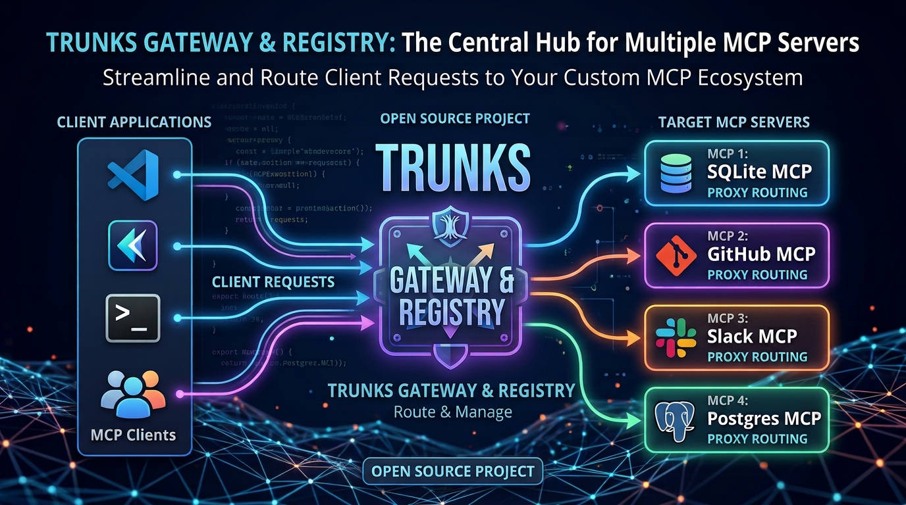

# Trunks

**Run all your MCP servers behind one endpoint.**

Trunks is a self-hosted MCP gateway and registry written in Rust. Register your
MCP servers once; let Claude, Cursor, Copilot, Codex and your own agents connect
to a single Streamable HTTP endpoint with unified discovery, tool groups, access
control and metrics.

Built in Rust: one small binary, instant start-up, no runtime to babysit. v1
delivers the gateway, registry, CLI, teams with per-resource grants, single sign-on
(OIDC) for people and a `line://ui` web app; the roadmap adds OIDC for MCP clients,
organisations and declarative configuration. See `docs/`.

> Status: **pre-alpha**. The gateway, registry, CLI, access model and single sign-on are
> implemented and tested; the web app and the first tagged release are still to come
> (`docs/03-plano.md`).

## Quickstart

```bash
# install (or: cargo install --locked --git https://github.com/websublime/trunks trunks)
curl --proto '=https' --tlsv1.2 -LsSf \
  https://github.com/websublime/trunks/releases/latest/download/trunks-installer.sh | sh

trunks start --host 127.0.0.1          # development mode: no authentication, local use only

# in another terminal: register an MCP server, then call one of its tools through the gateway
trunks register --name everything \
  --command npx --arg -y --arg @modelcontextprotocol/server-everything --session-mode stateful
trunks invoke everything__echo --input '{"message":"hello"}'

# point an MCP client at the gateway
claude mcp add --transport http trunks http://127.0.0.1:8080/mcp
```

The [quickstart](docs/guide/quickstart.md) explains each step.

## Documentation

The user guide is in [`docs/guide`](docs/guide/README.md):

| Page | What it covers |
|---|---|
| [Quickstart](docs/guide/quickstart.md) | From nothing to a tool call through the gateway |
| [Concepts](docs/guide/concepts.md) | Names, modes, sessions, groups, identities |
| [Upstream servers](docs/guide/upstreams.md) | Registering stdio and HTTP servers, credentials, OAuth |
| [Tool groups](docs/guide/tool-groups.md) | Curated subsets of tools on their own endpoint |
| [Enterprise mode](docs/guide/enterprise.md) | Users, teams, grants, MCP client tokens, single sign-on |
| [Connecting clients](docs/guide/clients.md) | Claude Code, Claude Desktop, Cursor, VS Code |
| [Operations](docs/guide/operations.md) | Install, database, network, observability, upgrades |
| Reference | [CLI](docs/guide/reference/cli.md) · [Configuration](docs/guide/reference/configuration.md) · [HTTP API](docs/guide/reference/api.md) |

Design documents, for people working on Trunks itself (written in Portuguese, pt-PT, with
English technical terms):

| Doc | What it covers |
|---|---|
| [`docs/01-produto.md`](docs/01-produto.md) | Product: what, for whom, concepts, decisions |
| [`docs/02-especificacao.md`](docs/02-especificacao.md) | Technical specification |
| [`docs/03-plano.md`](docs/03-plano.md) | Execution plan: phases, milestones, definition of done |
| [`docs/04-arquitectura.md`](docs/04-arquitectura.md) | Architecture views (C4, sequences, data, deployment) and ADRs |
| [`docs/05-roadmap.md`](docs/05-roadmap.md) | Beyond v1: `line://ui` web app, OIDC, organisations and teams, governance |
| [`docs/06-analise-db.md`](docs/06-analise-db.md) | Data-access layer analysis and decision (sqlx, no ORM) |
| [`docs/07-desempenho.md`](docs/07-desempenho.md) | Benchmark results and how to reproduce them |

## Layout

```
crates/
  trunks-types/      shared contracts: canonical names, enums, REST types
  trunks-core/       domain: registry, catalog, gateway, sessions, identity, OAuth
  trunks-db/         data access (SQLite | PostgreSQL), explicit SQL, migrations
  trunks-api/        axum router, middleware, REST + MCP mounts
  trunks-client/     HTTP SDK for the management API
  trunks-dashboard/  embedded web app assets
  trunks/            the `trunks` binary: server (`start`) + management CLI
web/app/             web application (line://ui) — see web/README.md
xtask/               repo automation (`cargo xtask build-dashboard`, `cargo xtask ci`)
docs/                design documents; docs/guide is the user guide
tests/               conformance fixtures and black-box tests
```

## Development

```bash
cargo build
cargo test --workspace
cargo xtask ci            # fmt --check, clippy -D warnings, tests
cargo run -- start        # http://127.0.0.1:8080/health
cargo run -- version
```

Requirements: Rust stable ≥ 1.94 (edition 2024). Node 20 is only needed to build the web app.

## Releases

Built and published with [`cargo-dist`](https://opensource.axo.dev/cargo-dist/):
archives for Linux/macOS/Windows (x86_64 and arm64), shell and PowerShell
installers, checksums. Container images (`ghcr.io/websublime/trunks`, plus a `-stdio`
variant with Node.js and uv) are built by the `docker` workflow; see
[Operations](docs/guide/operations.md) and [`CHANGELOG.md`](CHANGELOG.md).

## License

[MPL-2.0](LICENSE).
