# Trunks — Documento de Arquitectura

> Versão 2.0 (2026-11-04). Complementa `02-especificacao.md` (que detalha contratos e módulos); este documento dá as **vistas** — contexto, contentores, componentes, runtime, dados, deployment — e regista as decisões arquitecturais. Diagramas em Mermaid (renderizam no GitHub e no VS Code).
> Estrutura inspirada em C4 + arc42, sem cerimónia.

---

## 1. Objectivos e restrições arquitecturais

| Objectivo | Como se reflecte na arquitectura |
|---|---|
| Contratos estáveis (REST, CLI, DB) | Camada `trunks-types` isola os shapes JSON; `trunks-db` isola o schema |
| Um só binário, um só processo | `trunks start` liga tudo; CLI é cliente HTTP do mesmo binário |
| Fail-closed por construção | Autorização é um tipo (`Principal`) que o handler recebe obrigatoriamente, não um valor opcional num contexto |
| Baixo custo operacional | Sem GC, arranque < 500 ms, catálogo em memória, DB só para mutações e arranque |
| Isolamento do SDK MCP | `rmcp` só é visível em `trunks-core::gateway` e `trunks-core::upstream`; o resto do domínio não o importa |
| Sem ORM (D11) | Repositórios com SQL explícito atrás de traits; o domínio nunca vê a lib de DB |

Restrições: Rust stable; `rmcp` 3.8 (spec MCP 2026-07-28, sem SSE); dois dialectos SQL (SQLite/Postgres); web app em `line://ui` (D2).

## 2. Vista de contexto (C4 nível 1)

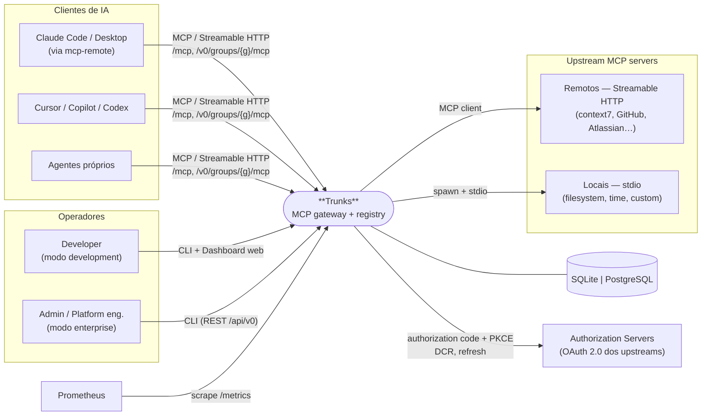

Fronteiras de confiança: tudo o que entra por `/mcp` e `/api/v0` é **não confiável** até o middleware produzir um `Principal`; tudo o que sai para upstreams carrega **só** credenciais configuradas no gateway — nunca headers do cliente.

## 3. Vista de contentores (C4 nível 2)

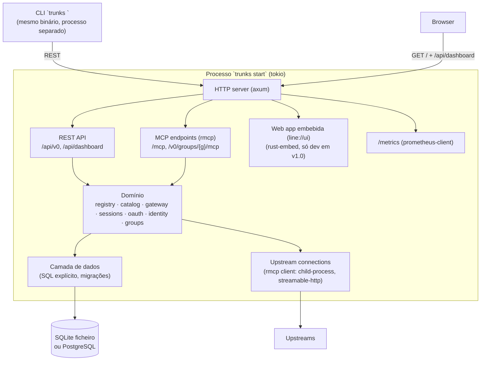

| Contentor | Tecnologia | Responsabilidade | Estado |
|---|---|---|---|
| HTTP server | axum 0.8 + tower | routing, middleware (auth, init, limites, trace) | sem estado |
| REST API | handlers axum | binding JSON, mapeamento erros→HTTP, shapes compatíveis | sem estado |
| MCP endpoints | `rmcp::StreamableHttpService<GatewayHandler>` | protocolo MCP downstream | sessões downstream (legacy mode) em memória |
| Domínio | `trunks-core` | regras de negócio, autorização, catálogo | `Catalog` (ArcSwap), `SessionManager` (DashMap) |
| Camada de dados | `trunks-db` | SQL, migrações, dois dialectos | — |
| Upstream connections | `rmcp` client | ligações stdio/http, OAuth client | processos filhos, ligações HTTP |
| Web app | Lit + `line://ui` | UI dev-only em v1.0; consola autenticada a partir de v2.0 | browser |
| CLI | clap + `trunks-client` | gestão via REST | `~/.trunks.conf` |

## 4. Vista de componentes (C4 nível 3) — crates e módulos

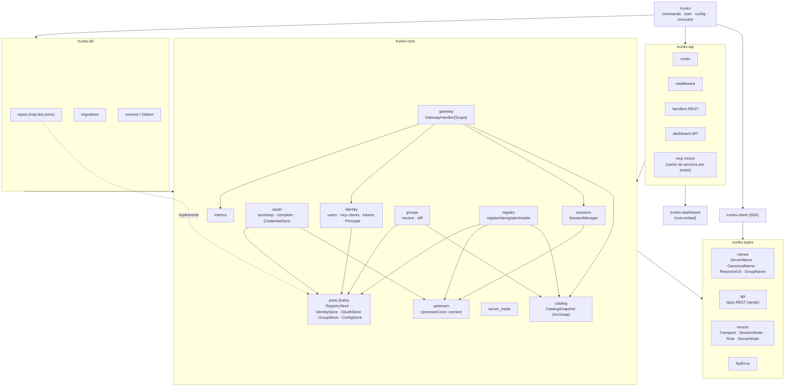

Regras (verificadas por `cargo-deny`/testes de arquitectura com `cargo-modules` ou simples `grep` em CI):

- `trunks-core` **não** importa axum, nem a lib de DB, nem `clap`. Importa `rmcp` apenas em `gateway` e `upstream`.
- `trunks-types` não importa nada além de `serde`/`serde_json`/`snafu`/`base64`.
- `trunks-client` não importa `trunks-core` nem `trunks-db` (é um SDK público).
- Só `trunks` conhece todos os crates — é a *composition root*.

## 5. Vistas de runtime

### 5.1 Arranque

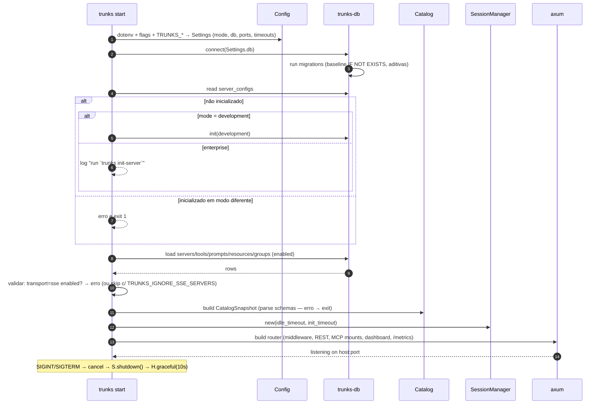

### 5.2 Registo de um upstream (sem OAuth)

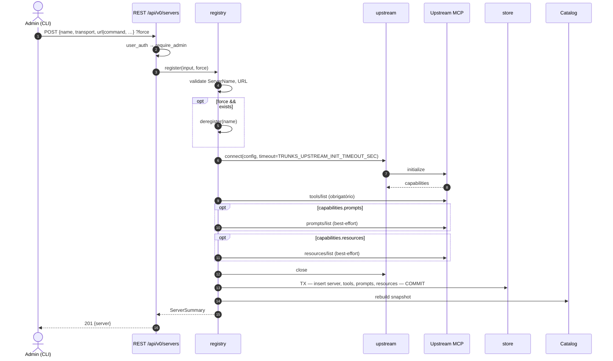

Nada é persistido se o `initialize` falhar. Se o upstream responder 401 com `WWW-Authenticate`, segue §5.4.

### 5.3 Chamada de tool via `/mcp` em modo enterprise

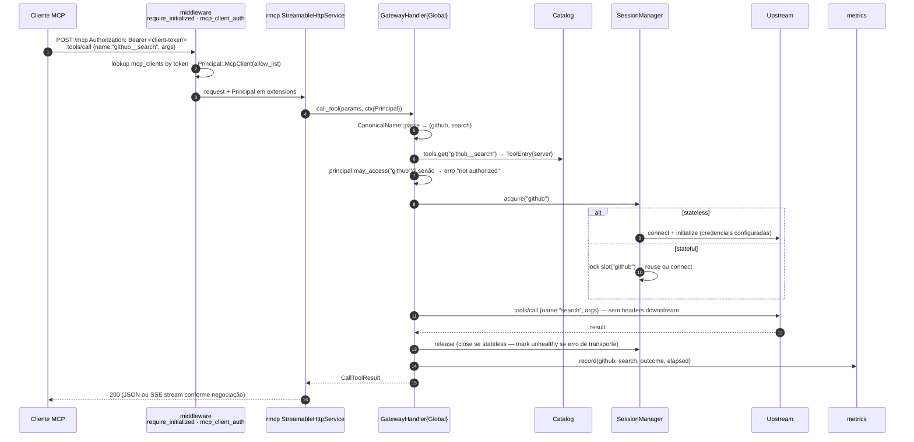

`list_tools` segue o mesmo caminho até ao passo 6 e filtra o catálogo pela allow-list; sem `Principal` em enterprise devolve lista vazia.

### 5.4 OAuth upstream — bootstrap e completion

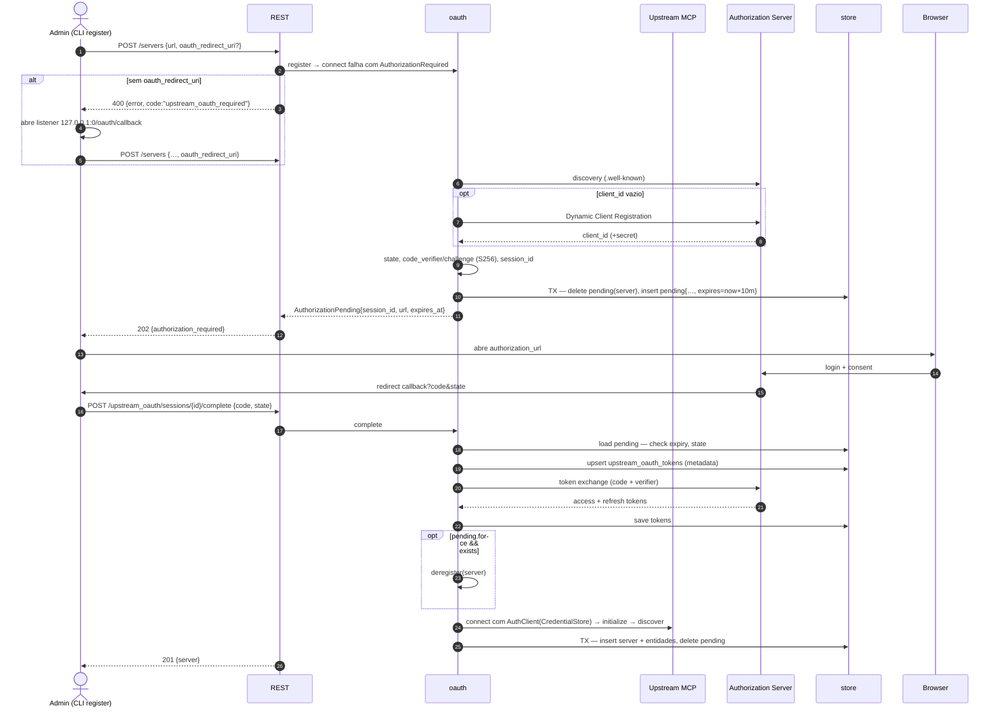

Tokens são **gateway-scoped**: uma linha em `upstream_oauth_tokens` por servidor, usada por todas as chamadas, com refresh automático pelo `AuthClient`.

### 5.5 Ciclo de vida de uma sessão stateful

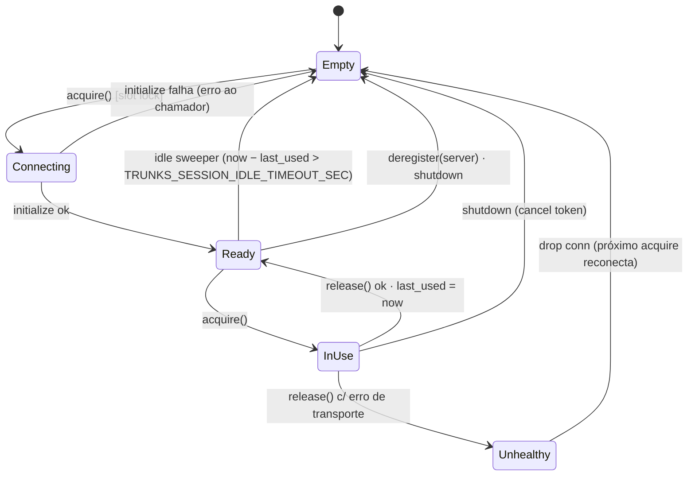

Em modo stateless não há slot: `acquire` = `Connecting→Ready→InUse`, `release` = drop.

### 5.6 Pipeline de um pedido HTTP

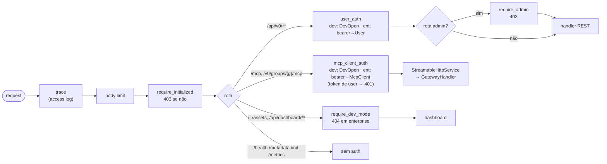

## 6. Vista de dados

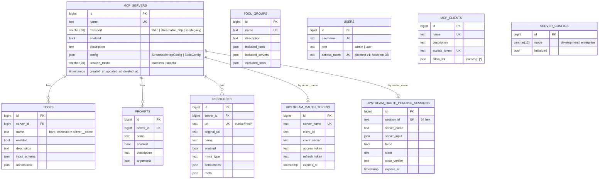

Notas:
- `TOOL_GROUPS` referencia tools/servidores **por nome** em JSON, não por FK — permite grupos "degradados" que sobrevivem a deregistos.
- `deleted_at` existe em todas as tabelas (herança do schema legacy). Trunks faz hard-delete e filtra `deleted_at IS NULL` nas leituras para ignorar lixo de versões antigas.
- Estado em memória derivado da DB: `CatalogSnapshot` (tudo o que é `enabled`) e `GroupView` (effective tools pré-resolvidas). Reconstruído por inteiro após cada mutação.

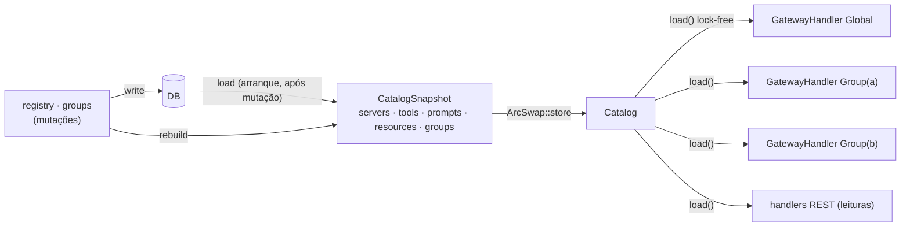

## 7. Vistas de deployment

### 7.1 Local (developer, modo development)

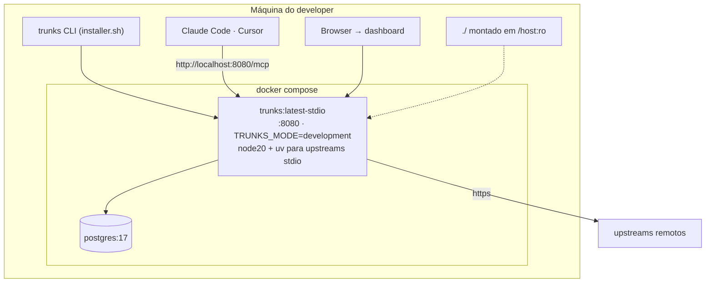

Alternativa sem Docker: `trunks start` com SQLite em `./trunks.db`.

### 7.2 Partilhado (equipa, modo enterprise)

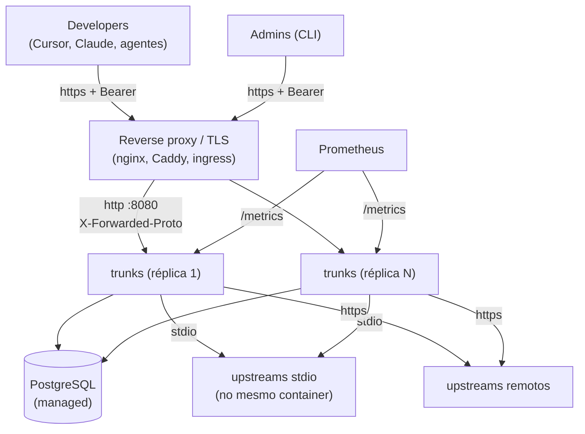

Limites conhecidos para N > 1 réplicas (a resolver pós-v1):
- Sessões **stateful** são por processo; com várias réplicas sem sticky sessions cada réplica tem a sua.
- O `Catalog` é reconstruído pela réplica que fez a mutação; as outras só o vêem no próximo arranque. Mitigação simples na v1.x: `LISTEN/NOTIFY` em Postgres ou um TTL de refresh configurável. Até lá, enterprise com 1 réplica, como o original.
- Sessões downstream em `legacy_session_mode` do `rmcp` são em memória; `StreamableHttpServerConfig.session_store` permite externalizar quando for preciso.

## 8. Conceitos transversais

### 8.1 Erros (`snafu`)

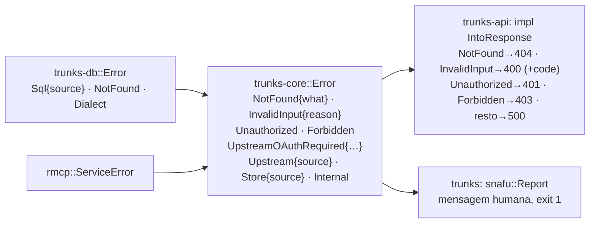

- Cada crate tem o seu `enum Error` com `#[derive(Snafu)]`; conversões explícitas por `context()`, nunca `From` implícito entre camadas — preserva a classificação (`NotFound` vindo da DB não vira 500 por acidente).
- Mensagens que o CLI/testes dependem são **constantes** em `trunks-types` (ex.: `"server is not initialized"`), não strings inline.
- `Whatever` só no `main` do binário.

### 8.2 Configuração
Precedência fixa: flag explícita > env var > ficheiro `.env` (via `dotenvy`, só preenche env) > default. Resolvida uma vez em `Settings` (struct imutável) passada por `Arc`. Tabela completa em `02-especificacao.md` §9.

### 8.3 Observabilidade
- `tracing` com spans por pedido (`http.request`), por chamada upstream (`upstream.call{server,tool}`), por sessão (`upstream.session{server,mode}`). Campos nunca incluem tokens/headers/env.
- Métricas em `prometheus-client`; registry único injectado; `Noop` quando desligado.
- `/health` é liveness; **readiness** = `/health` + catálogo construído (novo campo `"catalog":"ready"` — aditivo, compatível).

### 8.4 Segurança — fronteiras

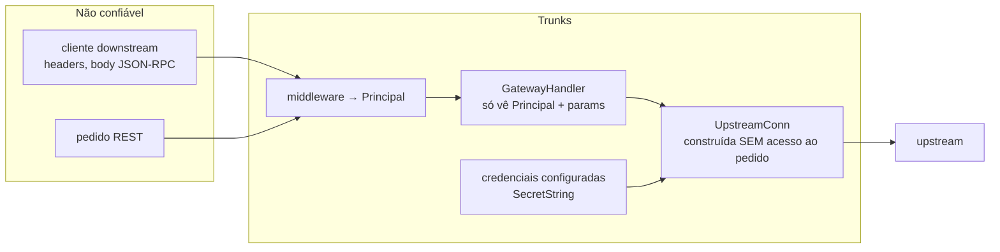

Propriedade central: `UpstreamConn::connect(config)` não recebe o pedido downstream — o strip de headers é estrutural, não um `request.Header = nil` que alguém pode esquecer.

## 9. Decisões arquitecturais (ADR resumido)

| ADR | Decisão | Alternativa rejeitada | Motivo |
|---|---|---|---|
| A1 | Um `GatewayHandler` parametrizado por `Scope` sobre um `Catalog` partilhado | N servidores MCP (um por grupo) com registo próprio | Elimina callbacks de sincronização e duplicação de estado; grupos passam a ser vistas |
| A2 | `Catalog` em `ArcSwap`, rebuild total por mutação | Cache por entidade com invalidação fina; ou DB por pedido | Mutações são raras e o conjunto é pequeno; rebuild total é trivialmente correcto |
| A3 | `Principal` tipado em `Parts.extensions` → `RequestContext` (validado no Spike S1) | Contexto dinâmico; um service por principal | Fail-closed por tipo; sem panics; testável sem HTTP |
| A4 | Lock por servidor no `SessionManager` | Lock global | Um upstream lento não bloqueia os outros |
| A5 | Ports (traits) no domínio, repos em `trunks-db` | Domínio a chamar SQL directamente | Testes de domínio com stores em memória; D11 pode mudar a lib sem tocar no domínio |
| A6 | SQL explícito, sem ORM (D11) | sea-orm / diesel | Decisão do produto; controlo do SQL em dois dialectos; schema é pequeno (10 tabelas) |
| A7 | `snafu` com um `Error` por crate (D10) | `thiserror` + `anyhow` | Context selectors obrigam a classificar erros na fronteira de cada camada |
| A8 | Sem SSE (D4) | Implementar SSE à mão | Deprecado no spec; `rmcp` não o tem; custo sem retorno |
| A9 | Web app em Lit + `line://ui`, embebida no binário (D2) | React; Rust/WASM | Design system próprio; a app cresce para consola autenticada (OIDC, orgs) |
| A10 | `cargo-dist` para release (D9) | pipeline à mão com Actions | Padrão do ecossistema; instaladores e checksums incluídos |
| A11 | `prometheus-client` directo, sem OTel SDK | OTel SDK + exporter Prometheus | Sem OTLP em v1, OTel só adiciona peso; reavaliar quando OTLP entrar (v3) |
| A12 | Rust 2024, `clippy::unwrap_used` em `core`/`api` | — | Sem panics em request path |

## 10. Mapa para a especificação

| Secção aqui | Detalhe em `02-especificacao.md` |
|---|---|
| §3 contentores | §2 workspace, §3 stack |
| §4 componentes | §4 domínio, §5 API, §6 SDK, §7 CLI |
| §5.1 arranque | §8 |
| §5.2–5.4 fluxos | §4.4 registry, §4.5 gateway, §4.8 OAuth |
| §5.5 sessões | §4.6 |
| §6 dados | §4.2 |
| §8 transversais | §9 config, §10 observabilidade, §11 segurança |
