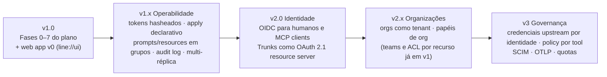
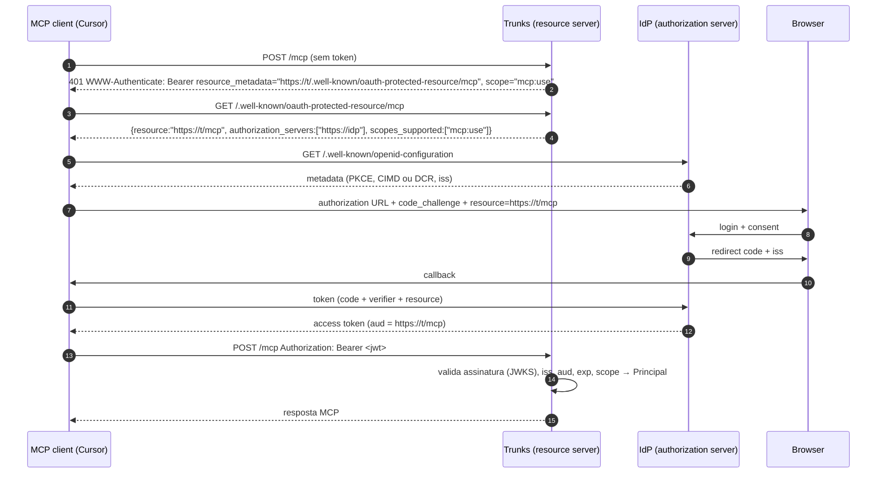
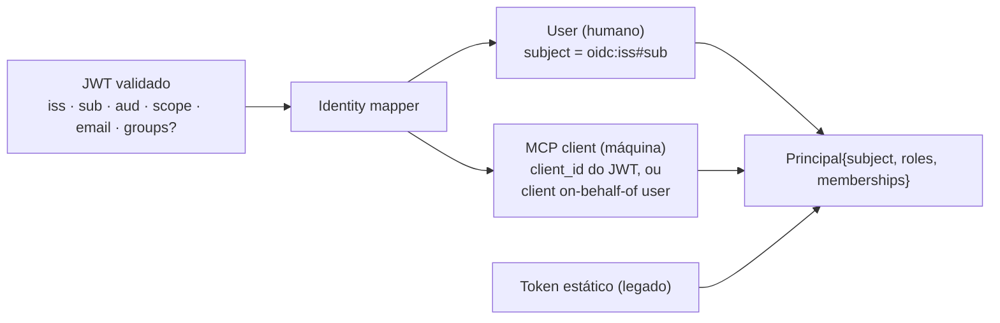
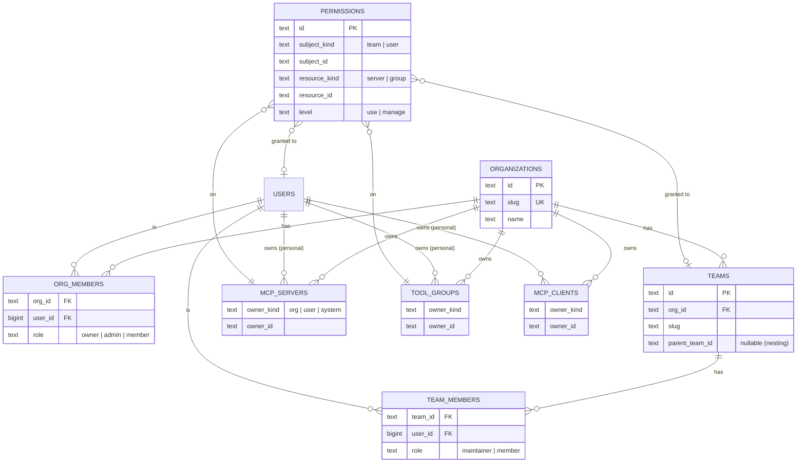
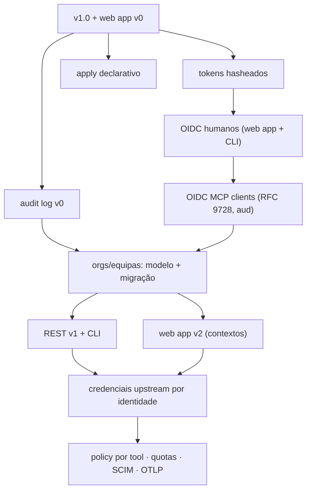

# Trunks — Roadmap

> Versão 2.1 (2026-11-05). Para lá de v1.0. Nota: teams, grants por recurso, web app em enterprise e OIDC para humanos **passaram para a v1** (D14–D17, `03-plano.md` Fase 6); aqui ficam OIDC para MCP clients, organizações multi-tenant e governança. Prioridades, não datas. Depende de `03-plano.md` (v1.0) e de `01-produto.md` (decisões).

---

## 1. Princípios

1. **v1.0 primeiro, depois diferenciação.** Nada do roadmap entra antes de v1.0 estar verde na suite de conformidade. Excepção: decisões de modelo de dados que ficariam caras de mudar depois (ver §6).
2. **`/api/v0` congelada.** O contrato v0 mantém-se dentro das séries 1.x e 2.x; funcionalidade nova vive em `/api/v1`. Um deployment single-tenant continua a funcionar sem saber que existem organizações.
3. **Identidade é uma camada, não um modo.** Tokens estáticos (v1.0), OIDC (v2.0) e, mais tarde, outros métodos produzem o mesmo `Principal`; o domínio nunca sabe como o principal foi autenticado.
4. **Standards, não invenções.** Para MCP clients, o spec MCP 2026-07-28 já define como se faz: Trunks é um *OAuth 2.1 resource server*, o IdP é o *authorization server*. Não se inventa um protocolo de login próprio.
5. **A web app é produto, não painel de debug.** Hoje o dashboard é dev-only e sem auth. Passa a ser a consola autenticada de operação do gateway, construída com `line://ui`.

## 2. Horizontes



| Horizonte | Objectivo | Pergunta que responde |
|---|---|---|
| v1.0 | Gateway completo, operável por CLI e web app | "Posso usar isto hoje, sozinho ou em equipa?" |
| v1.x | Operar com confiança | "Consigo gerir isto por GitOps e dormir descansado?" |
| v2.0 | Sem tokens estáticos | "O Cursor faz login no meu IdP e já está?" |
| v2.x | Multi-org | "Duas organizações na mesma instância sem se verem?" (multi-equipa já em v1) |
| v3 | Governança fina | "Quem usou que tool, com que credencial, e posso limitar?" |

## 3. v1.0 (+ web app v0)

Conforme `03-plano.md`; a Fase 6 entrega a primeira versão da web app em `line://ui` (D2).

### 3.1 Web app v0 (`web/app`)
- Stack: Astro estático + `line://ui` (`@websublime/line-*`), TypeScript, sem framework de UI nem router de cliente (D18, `08-web-app.md`); `line-` components, tokens `--line-*`, dark-first como o showcase.
- Âmbito, contra a API `/api/dashboard/*`: overview, servidores (registar incl. OAuth upstream via popup + polling, apagar, toggle), tools/prompts (toggle), tool groups (criar/apagar), resources, diagnósticos.
- Em v1 a web app existe em ambos os modos, autenticada em enterprise (token ou OIDC, D15/D16); `/api/dashboard` é só leitura e as mutações usam `/api/v0`.
- Embebida em `crates/trunks-dashboard` via `cargo xtask build-dashboard`.
- Esforço: ~3 semanas. Total v1.0 ≈15,5 semanas-pessoa.

### 3.2 Decisões de modelo tomadas já em v1.0 por serem baratas agora e caras depois
- Todas as tabelas novas de Trunks (não as herdadas) usam `id` ULID/UUID em texto, não `bigint` — facilita federação/exports; as herdadas mantêm `bigint` por compat.
- `mcp_clients` e `users` ganham, via migração aditiva, colunas nulas `subject` (identificador externo, ex. `oidc:<issuer>#<sub>`) e `owner_kind/owner_id` — preenchidas só a partir de v2.x. Ver §6.

## 4. v1.x — Operabilidade

| Item | Descrição | Notas |
|---|---|---|
| Tokens hasheados | `access_token_hash` (SHA-256) em `users`/`mcp_clients`; migração in-place; `GET /clients` deixa de devolver o token (breaking documentado; flag de compat por 1 minor) | pré-requisito de qualquer história de segurança |
| `trunks apply -d <dir>` | Reconciliação declarativa (inverso de `export`): servidores, grupos, clients, users; `--prune`; `--dry-run` com diff | GitOps |
| Prompts e resources em grupos | `included_prompts`, `included_resources` no grupo; `Scope::Group` passa a filtrar os três | fecha a limitação de v1 |
| `--output json` no CLI | Todas as listagens e `get` | automação |
| Audit log v0 | Evento por chamada MCP e por mutação REST: `who, what, target, outcome, latency`, em `tracing` com target `trunks.audit` + opcional tabela `audit_events` | base para v3 |
| Multi-réplica | Invalidação do `Catalog` entre réplicas: `LISTEN/NOTIFY` em Postgres (ou polling com TTL em SQLite, que de qualquer forma é single-node) | desbloqueia HA em enterprise |
| Health de sessões stateful | ping periódico + reconnect com backoff | |
| Container images multi-arch | `latest`/`latest-stdio`, workflow próprio | se não entrou em v1.0 |

## 5. v2.0 — Identidade: OIDC

### 5.1 O que "suporte OIDC" significa em Trunks

Dois consumidores, um IdP:

| Consumidor | Hoje (v1.0) | v2.0 |
|---|---|---|
| **Humanos** (web app, CLI) | token estático de `user` | login no IdP (Authorization Code + PKCE); web app recebe sessão; CLI usa loopback `127.0.0.1` (já existe para OAuth upstream) ou Device Authorization Grant |
| **MCP clients** (Cursor, Claude, agentes) | token estático de `mcp_client` | fluxo do spec MCP: Trunks responde `401` + `WWW-Authenticate: Bearer resource_metadata=…`, publica RFC 9728, o cliente faz Auth Code + PKCE **directamente no IdP**, e envia um access token que Trunks valida |

Trunks **não** se torna authorization server. É resource server (o que o spec exige) e confia num IdP OIDC externo — Keycloak, Dex, Auth0, Okta, Entra ID, Google. Para quem não tem IdP, documenta-se Dex/Keycloak em `docker-compose`. Tornar Trunks um AS embebido (para uso local sem IdP) é opção de v3, não de v2.

### 5.2 Fluxo para MCP clients (spec 2026-07-28)



Obrigações de Trunks (MUST do spec): publicar Protected Resource Metadata (RFC 9728) por endpoint (`/mcp`, `/v0/groups/{g}/mcp` — cada um é um *resource* com o seu URI canónico); validar audience (RFC 8707); responder 401/403 com `WWW-Authenticate`; nunca aceitar nem reencaminhar tokens de outros emissores. Opcional: ext-auth (ID-JAG / XAA, `rmcp` feature `auth-enterprise-managed`) para cenários enterprise com IdP corporativo.

### 5.3 Mapeamento token → Principal



- Primeira vez que um `sub` aparece: **just-in-time provisioning** cria o `user` (role `user`) — configurável (`TRUNKS_OIDC_JIT=deny|user|admin-if-claim`).
- Role `admin` por claim (`groups` contém `trunks-admins`, ou `email` em lista) — configurável.
- Um MCP client OIDC actua **em nome do utilizador** que fez login no Cursor: o `Principal` é o utilizador, com as permissões dele. Deixa de ser preciso criar `mcp_client` por IDE. `mcp_clients` estáticos continuam a existir para agentes headless (`client_credentials` no IdP, ou token estático).

### 5.4 Configuração

```
TRUNKS_OIDC_ISSUER=https://idp.example.com/realms/x
TRUNKS_OIDC_AUDIENCE=https://trunks.example.com/mcp   # resource URI canónico
TRUNKS_OIDC_CLIENT_ID=trunks-web                       # para o login humano na web app
TRUNKS_OIDC_SCOPES=openid profile email
TRUNKS_OIDC_ADMIN_CLAIM=groups:trunks-admins
TRUNKS_OIDC_JIT=user
TRUNKS_AUTH_STATIC_TOKENS=true                         # manter tokens estáticos em paralelo (default true em 2.0, false em 3.0)
```

### 5.5 Entregáveis v2.0
- `trunks-core::identity::oidc`: validação JWT (JWKS com cache e rotação), mapper, JIT.
- Endpoints: `/.well-known/oauth-protected-resource[/…]`, `401/403` com `WWW-Authenticate`, `/api/v1/auth/{login,callback,logout,session}` para a web app (sessão em cookie `HttpOnly` + CSRF), `trunks login --oidc` no CLI.
- Web app: ecrã de login, sessão, "quem sou", gestão de users OIDC.
- Testes: Dex em `docker-compose` nos e2e; `wiremock` para JWKS nos unit tests; smoke com Cursor e Claude Code reais (ambos suportam o fluxo).
- Crates: `jsonwebtoken` ou `openidconnect` (reutiliza `oauth2`), `axum-extra` (cookies), `tower-sessions` opcional.

## 6. v2.x — Organizações e equipas (modelo "GitHub orgs")

### 6.1 Modelo



Semântica (decalcada do GitHub, simplificada):

| Conceito | Regra |
|---|---|
| **Organização** | Namespace de servidores, grupos e clients. `owner` gere tudo; `admin` gere recursos e equipas; `member` só o que lhe for concedido. |
| **Equipa** | Conjunto de membros da org; pode ser aninhada (uma equipa filha herda o que a mãe tem). `maintainer` gere membros. |
| **Namespace pessoal** | Cada user tem o seu: servidores e grupos "pessoais" (como repos pessoais). O que hoje é "o registry" passa a ser o namespace `system`, gerido por admins globais, para manter o comportamento de v1. |
| **Permissão** | `(subject: team|user, resource: server|group, level: use|manage)`. `use` = descobrir e invocar; `manage` = editar/activar/apagar. Efectiva = união de todas as concessões directas e via equipas (incl. aninhadas) + papel na org. **Sem deny** na primeira versão (como o GitHub). |
| **MCP client** | Pertence a um user (pessoal) ou a uma org. Acede ao que o dono pode, **intersectado** com a sua allow-list (nunca mais do que o dono). Clients OIDC on-behalf-of herdam o user. |
| **Grupo** | Pode incluir tools de qualquer servidor a que o **autor** tenha `use`; um consumidor do grupo precisa de `use` no grupo **e** nos servidores subjacentes (grupo não alarga — invariante de v1 mantido). |
| **Global admin** | Papel de instalação (equivale ao `admin` actual); vê e gere tudo. |

### 6.2 Compatibilidade com v1/`/api/v0`
- Migração cria a org implícita `system` e mapeia: todos os `mcp_servers`/`tool_groups` existentes → `owner = system`; `users.role=admin` → global admin; `mcp_clients` existentes → `owner = system` com a allow-list actual. `/api/v0` continua a operar sobre o namespace `system` — comportamento idêntico ao de hoje.
- Gateway: `/mcp` filtra pelo `Principal` efectivo (hoje allow-list; amanhã união de permissões). Endpoints novos por namespace: `/orgs/{org}/mcp`, `/orgs/{org}/groups/{g}/mcp`, `/users/{u}/mcp` — cada um é um *resource* OAuth distinto (RFC 9728), o que casa bem com v2.0.
- REST: `/api/v1/orgs`, `/api/v1/orgs/{org}/{members,teams,servers,groups,clients,permissions}`, `/api/v1/users/{u}/{servers,groups,clients}`, `/api/v1/me`.

### 6.3 Web app (v2.x)
Navegação por contexto, como o GitHub: switcher org/pessoal; páginas de org (servidores, grupos, equipas, membros, clients, settings); página de equipa (membros, acessos); página de servidor com separador *Access* (quem tem `use`/`manage`, por equipa e individual); auditoria por org.

### 6.4 CLI
`trunks org create|list|members add|teams create|…`, `trunks access grant --team data --server github --level use`, `--org`/`--user` em `register`, `create group`, `create mcp-client`. Default: namespace pessoal do utilizador autenticado; `--system` para o legado.

### 6.5 Esforço (ordem de grandeza)
Modelo + migração + autorização efectiva no gateway: 3 sem. REST v1 + CLI: 2 sem. Web app: 3–4 sem. Testes de autorização (matriz org/equipa/individual/aninhamento/clients): 1 sem. ≈ 9–10 semanas-pessoa.

## 7. v3 — Governança

- **Credenciais upstream por identidade**: o grant OAuth do `github` MCP deixa de ser gateway-scoped e passa a ser por user (ou por org) — o utilizador autoriza uma vez na web app; o gateway escolhe a credencial pelo `Principal`. É o que torna orgs realmente úteis.
- **Policy por tool**: allow/deny de tools individuais por equipa/user (hoje a granularidade é servidor), argumentos proibidos por regex/JSON-schema, rate limits e quotas por client/org.
- **Audit log v1**: tabela consultável, retenção, export; página na web app; `trunks audit --org x --since 1h`.
- **SCIM 2.0**: provisionamento de users/equipas a partir do IdP.
- **OTLP** export (traces + métricas); métricas por org/equipa.
- **AS embebido** (opcional): para deployments locais sem IdP, Trunks emite os seus próprios tokens — só se houver procura real.

## 8. Ordem de ataque e dependências



## 9. Questões em aberto (para decidir antes de cada horizonte)

| # | Questão | Quando |
|---|---|---|
| Q1 | A web app v0 entra em v1.0 (atrasa ~2 sem.) ou sai em v1.1 com v1.0 a entregar só a API `/api/dashboard`? | Fase 5 |
| Q2 | Licença: manter MPL-2.0 ou mudar para Apache-2.0/MIT alinhado com o resto do `websublime`? (D12) | antes do primeiro release público |
| Q3 | IdP de referência para docs e e2e: Dex (leve, OSS) vs Keycloak (mais próximo de enterprise real). | início v2.0 |
| Q4 | Equipas aninhadas na primeira versão ou só planas? (GitHub tem; custo real está na resolução de permissões) | início v2.x |
| Q5 | Namespace pessoal desde v2.x ou só orgs? (pessoal implica quota/limpeza de servidores stdio por user) | início v2.x |
| Q6 | Trunks como AS embebido para uso local sem IdP — há procura? | v3 |
